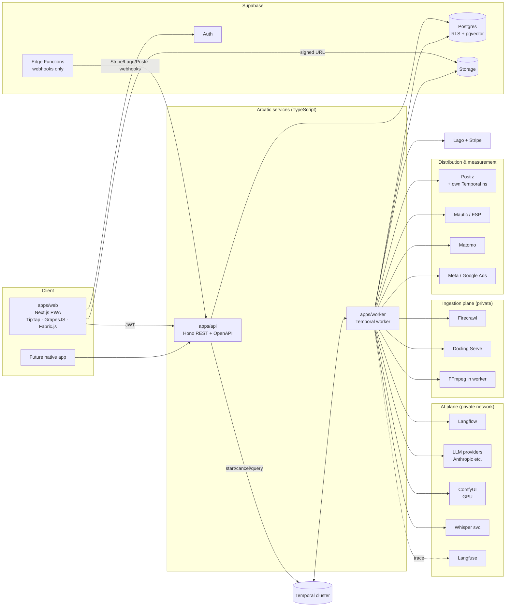

# 01 — Architecture Blueprint

## 1. System diagram



**Rules**
1. Browser talks only to `apps/api`, Supabase Auth and Storage (signed URLs). Every third-party service sits on a private network.
2. `apps/api` never calls slow third parties synchronously; it writes a row + starts a Temporal workflow and returns `202 {job_id}`.
3. Postgres is the source of truth for tenancy, status and money. Temporal is the source of truth for *execution*. A `job_events` table mirrors progress for the UI (Supabase Realtime).
4. Every tenant-scoped row carries `workspace_id`; RLS enforces it for user JWTs; the service role is used only inside `apps/api`/`apps/worker` and always filters by `workspace_id` explicitly (defence in depth).

## 2. Monorepo layout

```
arcatic-os/
  apps/
    web/            Next.js 15 App Router, Tailwind, shadcn-style UI, Supabase SSR auth
    api/            Hono on Node: REST, zod validation, OpenAPI, auth + workspace context
    worker/         Temporal worker process: registers workflows + activities
  packages/
    core/           Domain types, zod schemas, RBAC matrix, validators, Brand Context compiler, errors
    database/       Supabase clients (user/service), typed query helpers, generated DB types
    ai/             Provider interface, model registry & cost table, prompt templates, structured output
    integrations/   Adapters: Postiz, Firecrawl, Docling, Langflow, Lago, Langfuse, ComfyUI, Mautic, Matomo
    jobs/           Temporal workflow + activity definitions, job contracts, credit-hold pattern
    ui/             Design tokens + React primitives shared by web (and later native via tokens)
  supabase/
    migrations/     SQL schema, RLS, functions (credit ledger)
    seed.sql
  infrastructure/
    docker-compose.yml   profiles: core | ingest | ai | publish | billing | analytics | gpu
    env/                 per-service env templates
  docs/
```

## 3. Job / queue architecture

```mermaid
sequenceDiagram
  participant U as User (web)
  participant A as apps/api
  participant DB as Postgres
  participant T as Temporal
  participant W as Worker
  participant P as Provider (LLM/ComfyUI/Postiz)

  U->>A: POST /v1/workspaces/:ws/generations (Idempotency-Key)
  A->>DB: estimate cost; reserve_credits() (atomic)
  A->>DB: insert generation_jobs(status=queued, reservation_id)
  A->>T: startWorkflow(id = job.id)  // workflowId = job id → idempotent
  A-->>U: 202 {job_id}
  T->>W: run workflow
  W->>DB: job_events(progress 10%) / status=running
  W->>P: activity call (retry policy, heartbeat)
  P-->>W: result
  W->>DB: content_versions + provenance
  W->>DB: settle_reservation(actual_cost) / status=succeeded
  Note over W,DB: on failure: release_reservation(); status=failed, error
  U-->>DB: Realtime subscription on job_events
```

**Contracts (all workflows)**
- `workflowId = generation_jobs.id` (or `publishing_jobs.id`) → starting twice is a no-op.
- Activities are idempotent: they look up their output by `(job_id, step)` before redoing work.
- Retry: exponential backoff, max attempts per activity class (LLM 3, ComfyUI 2, publish 5 with platform-aware backoff, crawl 3).
- Cancellation: `POST /jobs/:id/cancel` → Temporal cancel → activities see `CancelledFailure` → release credits → `status=cancelled`.
- Heartbeats for anything > 30 s (crawl, render, transcription) carry progress → `job_events`.
- Task queues: `arcatic-default`, `arcatic-ingest`, `arcatic-gpu`, `arcatic-publish`, `arcatic-analytics` → independent scaling.
- Schedules: Temporal Schedules for analytics sync (hourly), campaign scheduled generation, learning rollups (nightly).

| Workflow | Queue | Steps |
|---|---|---|
| `crawlSourceWorkflow` | ingest | firecrawl map → batch scrape → clean → chunk → embed → upsert chunks |
| `ingestDocumentWorkflow` | ingest | storage fetch → docling → clean → chunk → embed |
| `ingestMediaWorkflow` | ingest | ffmpeg extract audio → whisper → chunk → embed |
| `brandExtractionWorkflow` | default | retrieve pages → Langflow extract → confidence + citations → brand_kit draft |
| `generateContentWorkflow` | default/gpu | reserve(credits) → compile Brand Context → retrieve → generate → validate → (image) ComfyUI → save version → settle |
| `renderVideoWorkflow` | gpu | timeline → ffmpeg graph → render → upload |
| `publishWorkflow` | publish | approval check → platform validation → Postiz create post → poll status → mirror result |
| `analyticsSyncWorkflow` | analytics | per connected account pull → normalise → performance_metrics |
| `learningRollupWorkflow` | analytics | aggregate learning_signals → insights → voice refinements (proposed, human-approved) |

## 4. Environments

| Env | Supabase | Temporal | Third-party services | Notes |
|---|---|---|---|---|
| local | `supabase start` (CLI) | `temporal server start-dev` or compose | compose profiles as needed | seed workspace + test user |
| staging | Supabase project `arcatic-staging` | Temporal Cloud ns `arcatic-staging` | single small VM / k8s ns; platform **sandbox/test apps** only | nightly E2E, publishing sandbox tests |
| production | Supabase project (Pro, PITR) | Temporal Cloud ns `arcatic-prod` | k8s (GPU node pool for ComfyUI/Whisper) | blue/green API, migrations gated |

See `08-deployment.md` for env vars and the compose file.
